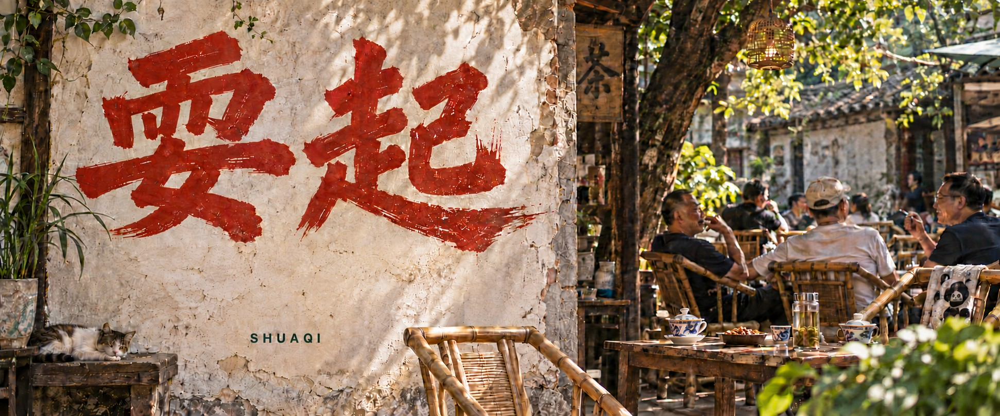

<div align="center">



**耍中找钱，找钱来耍，找耍结合，以耍为主。**

读点有意思的 · 找点好耍的 · 和投缘的人一起，把日子过起来

[先坐一会儿](#先坐一会儿) · [从这里逛起](#从这里逛起) · [今天怎么耍](#今天怎么耍) · [一起添把椅子](#一起添把椅子)

</div>

---

## 先坐一会儿

等忙完，等周末，等下个月，等一切都准备好了。

茶都续了三道，日子还在等。

**耍起**想把那些「以后再说」，慢慢变成「今天整起」。读点东西，捣鼓兴趣，出门走走，和朋友坐一下午。大有大的耍法，小有小的安逸。

这里由一个**耍起理论的搬运工**慢慢打理。好话搬过来，好耍的记下来；你有自己的耍法，也欢迎添一笔。

> 耍中找钱，找钱来耍，找耍结合，以耍为主。
>
> —— 李伯清「快乐经济十六字方针」，[相关报道](https://weibo.com/2/detail/5346772599965469)

## 从这里逛起

| 去处 | 里面有什么 | 现在走到哪儿 |
| :--- | :--- | :--- |
| **耍起知识** | 理论、语录、文章与不同观点。好东西有出处，读完可以有自己的想法。 | 首页先放几条阅读线索 |
| **耍起生活** | 一顿饭、一条路、一个兴趣。收集具体耍法，也记录真实感受。 | 从下面三个小提议开始 |
| **耍起社区** | 分享日常，交换耍法，找同好，约一场大家都愿意来的活动。 | 筹备中，先收集想法 |
| **耍起工具** | 帮你选活动、安排周末、发现附近好耍的地方。 | 等具体需求长出来 |

<details>
<summary><strong>耍起知识 · 先翻这几页</strong></summary>

- [南风窗：耍起主义，突然爆火](https://app3.myzaker.com/news/article.php?pk=6ab523308e9f096a7f6f3545) — 从李伯清的语录，谈到年轻人怎样理解「耍起」。
- [知著网：从大压抑到大耍起，当我们不需要玩出个名堂](https://www.huxiu.com/article/4890826.html) — 一种关于快乐与意义焦虑的解读。
- [川观新闻：李伯清谈烟火气与现实生活](https://cbgc.scol.com.cn/news/7428198) — 看看讲这番话的人，怎样谈生活、创作和年轻人。

这些是阅读线索。原话、评论和本站整理会分别注明；最早完整演出的时间与语境仍待核实。

</details>

## 今天怎么耍

先挑一个顺眼的。

**① 一杯茶的工夫**  
找个坐得舒服的地方，点杯喜欢的喝的。发会儿呆，翻两页书，看看路过的人。安逸就多坐一会儿。

**② 换条路回家**  
给自己留半小时，拐进平时没走过的街。看到有意思的小店就进去看看，看到晚霞就停一下。

**③ 把喜欢的捡回来**  
弹一首没练熟的曲子，画点东西，开一局游戏，做一道想吃的菜。先耍二十分钟，喜欢就接着来。

> 今天也算数。好耍就继续，累了就歇会儿。

## 一起添把椅子

带一条好话来，附上出处。带一个耍法来，说说怎么耍。带一段经历来，舒服的、踩坑的，都能聊。

可以通过 Issue 留个想法，也可以用 Pull Request 补充内容。暂时还没想好怎么写，就照这个填：

```text
今天怎么耍：
大概花了多少时间和钱：
最想分享的一刻：
出处或链接（如果有）：
```

理论知识只是其中一部分。往后，这里还想长出更多生活记录、一个能坐下来交流的社区，以及几个用得上的小工具。

---

<div align="center">

**今天，耍起。**

<sub>引用注明出处，整理说明来路。页面口号与生活提议为本站文案。</sub>

</div>
